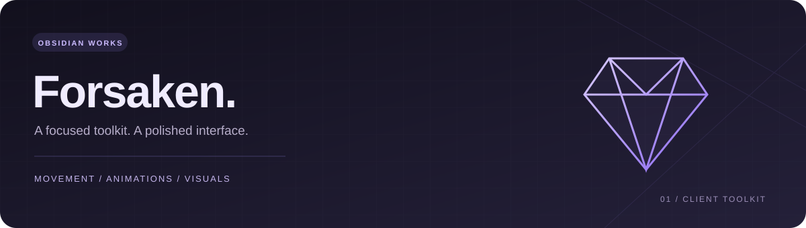

<p align="center"></p>

# Obsidian Works · Forsaken

Public distribution for the Forsaken client toolkit. This repository contains the loader, encoded build, and required license notices. Development source and build tools are maintained privately.

```lua
loadstring(game:HttpGet("https://github.com/ObsidianWorkss/Forsaken/releases/latest/download/loader.lua"))()
```

Your existing loadstring remains unchanged. There is one **Current build** release, updated in place. The loader always downloads its current encoded build. You do not need to change URLs or choose an old version. Right Shift toggles the menu unless your saved profile uses another hotkey.

Ten tabs and 51 controls include movement targets, a local unlimited-sprint fallback and optional infinity meter, animation presets and custom assets, player/object markers, generator assistance, camera controls, graphics settings, profiles, and cleanup.

Settings save and load through the same executor workspace. The local infinity meter does not modify game-owned stamina in fallback mode. Automated generator repair completion remains unverified.

Client-side obfuscation is reversible and does not guarantee resistance to reverse engineering. Files already downloaded from earlier public versions cannot be recalled.

Interface powered by [WindUI](https://github.com/Footagesus/WindUI). Its MIT license is retained in [licenses/WindUI.LICENSE](licenses/WindUI.LICENSE).
